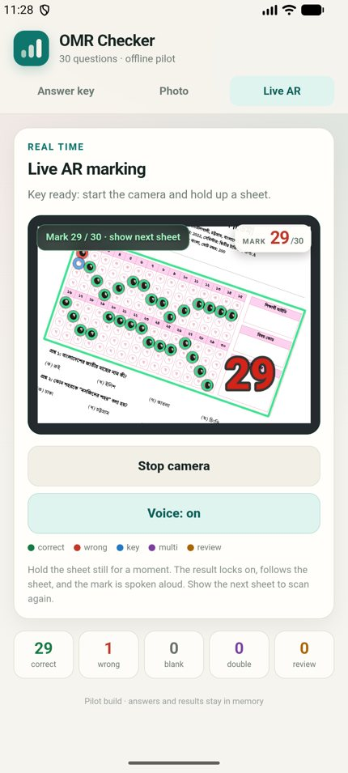

# OMR Checker — Android pilot

An offline Android app for the 30-question answer sheet in
`templates/q-paper.json`. A teacher sets the correct answers, then either:

- points the live camera at a sheet and gets the mark drawn directly on the
  sheet while it is read aloud, or
- takes/chooses a still photo and gets a normal result screen.

Nothing is uploaded and no key or result is saved.

**APK:** [OMR-Checker-pilot.apk](OMR-Checker-pilot.apk) (version 1.1-live-ar)



## Install on the phone

1. Copy `OMR-Checker-pilot.apk` to the Android phone (USB, Drive, or any file
   transfer method).
2. Open it. Android will ask to allow installing from that app; allow it for
   this one install.
3. The app is called **OMR Checker** and needs Android 7.0 or newer.

The build is signed with a local debug key. It is for testing, not a Play Store
release. The camera permission is requested the first time **Start live scan**
is tapped.

## Set the answer key

On the **Answer key** tab:

- tap the correct option for all 30 questions (`ক` = 1, `খ` = 2, `গ` = 3,
  `ঘ` = 4), or
- paste 30 answers as digits (`223432…` or `2,2,3,4,…`) and press **Apply**.

One mark per question. The key stays in memory only; reopening the app starts
with an empty key.

## Live AR scan

1. Set all 30 answers.
2. Open the **Live AR** tab and tap **Start live scan**.
3. Allow the camera when Android asks.
4. Hold the sheet so the whole pink answer frame is visible and reasonably
   close to the camera. Fill most of the preview; a sheet that is very small in
   the frame may not be found.
5. Hold still for a moment. The app:
   - outlines the sheet,
   - draws green rings on correct answers, red on wrong answers, blue on the
     teacher's key when the student chose another option, purple on
     double-marked questions, and amber markers on blank/review questions,
   - writes the total mark into the printed **total marks** box on the sheet,
   - speaks the mark in English, for example “Mark 29 out of 30.”
6. The overlay follows the sheet while it stays in view. Remove the sheet to
   clear the result, then show the next one. A new sheet is detected
   automatically.

**Voice: on/off** mutes or restores the spoken mark. The total and marks stay
on screen either way.

If the camera is not found, or the sheet is not being detected, move closer so
the pink frame is larger, avoid glare, and keep the whole frame inside the
preview. The app reads entirely on the phone.

## Still-photo scan

The **Photo** tab keeps the original workflow:

1. Tap **Scan answer sheet** for the system camera, or **Choose a photo**.
2. Keep the entire pink answer area inside the photo. The sheet does not need
   to be perfectly straight.
3. The result shows the total, correct/wrong/blank/double/review counts, a
   marked preview, and a question-by-question breakdown.

Use this when live detection is difficult, for example in poor light or with a
sheet that is far away.

## How the live mode works

- A WebView camera stream (`getUserMedia`) provides frames without leaving the
  app.
- The existing offline engine finds the printed pink frame (or the page
  outline), maps it to the 150 DPI template, and grades the bubbles.
- The inverse homography projects every grade result back onto the current
  camera frame, so the circles sit on the printed bubbles and the total sits in
  the printed mark box rather than in a separate result panel.
- The sheet is tracked continuously. A scan is taken after the corners are
  stable for about 300 ms; the result stays locked and follows the sheet until
  it is removed or moved to a new position.
- The mark is spoken through Android's native `TextToSpeech` bridge, with the
  browser speech API as a fallback.
- The camera is released when the app is backgrounded or another tab is
  opened. The key is kept in memory.

Processing is near-real-time, not video-frame-rate. A lock-in takes roughly a
second or two depending on the phone; the video preview itself stays live.

## Verification done

- Android emulator (API 37):
  - APK installs and updates over the previous pilot.
  - Answer key entry works by paste.
  - Live AR camera preview starts with the virtual back camera.
  - Runtime camera permission prompt appears on first use and the camera starts
    after **While using the app** is chosen.
  - App backgrounding stops the live camera and returns to the start state.
- Full AR pipeline inside the Android WebView (synthetic camera frame of
  `Asset 1@4x.png`, sample key): **29/30, 1 wrong, 0 review**, with the green /
  red / blue circles, green sheet outline, and **29** in the printed total box.
- Native TTS: logcat shows a Google TTS synthesis request immediately after the
  AR mark is produced.
- Desktop browser with a synthetic camera feed:
  - upright sheet: **29/30** with overlay;
  - sheet rotated 6°: **29/30**, circles and total remained registered.
- Still-photo engine sample suite with the sample key:
  - `Asset 1@4x.png`, `Asset 2@4x.png`, `q-paper_tilted.jpg`: **29/30**;
  - `q-paper_mixed.png`: **2/30**, 1 double-marked and 1 review;
  - `q-paper_blank.png`: **0/30**.

A physical phone camera, printed sheet, real lighting, and a classroom stack
still need testing. The emulator and synthetic feed are not a substitute for
those.

## Limits of this pilot

- Only the current 30-question / 4-option sheet geometry.
- One mark per question; per-question marks are not editable.
- No student ID, subject code, CSV export, database, or result history.
- No manual correction screen after a scan.
- Live mode needs the pink frame to be reasonably large and in focus. Very
  small, glared, or badly creased sheets may fall back to the still-photo mode.
- The spoken phrase is English only.
- If the sheet design changes, `assets/template-data.js` and the bubble
  geometry assumptions must be regenerated/updated; the engine is not a generic
  OMR designer.

## Build

Prerequisites on this machine:

- Android SDK with build-tools and a platform (the script selects the newest).
- Android Studio's bundled JDK at
  `C:\Program Files\Android\Android Studio\jbr`.

```bash
bash android-app/build_apk.sh
```

The script compiles resources with `aapt2`, compiles the Java shell, dexes with
`d8`, aligns, signs with `debug.keystore`, and writes
`android-app/OMR-Checker-pilot.apk`. The first build creates the debug keystore;
keep it so later APKs update the installed app instead of requiring an
uninstall.

The app is plain Java plus local HTML/CSS/JS; there is no Gradle project and no
third-party runtime dependency.
